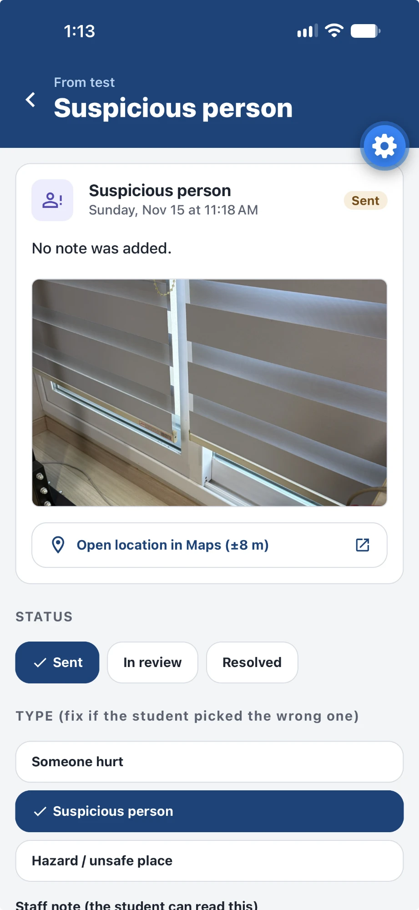

**What I tested:**
After building the admin panel, I tested it on my phone with two app accounts:
a student account ("test") and an admin account ("Administrator").
The goal was to check two things: that the admin can do their job,
and that the student **can't** do the admin's job.

**My test table:**

| # | Account | What I did | Expected | Result |
|---|---|---|---|---|
| 1 | Admin | Open Home | White "Admin" button in the header | ✅ (only after logging in again) |
| 2 | Admin | Open All reports | Every student report, with counts per status | ✅ 3 reports, all "Sent" |
| 3 | Admin | Open the report with a photo | Sender, time, photo, location link | ✅ |
| 4 | Admin | Set status to "In review" and add a staff note | Saved, and the list updates | ✅ "In review · 1" |
| 5 | Student | Open Home | **No** Admin button | ✅ |
| 6 | Student | Check My reports | New status and the staff note | ✅ "Campus safety: staff is checking the area" |
| 7 | Both | Two devices at once, send a new report | It appears on the admin list by itself | Not tested yet |

Rows 5 and 6 are the security part. Testing what a user *shouldn't* be able to do
is just as important as testing what they should.

**The bug:**
The code checks (TypeScript and the linter) all passed. But on my phone, the filter buttons
at the top of the admin list were huge. They stretched down to fill half the screen.

The reason: a sideways-scrolling row (`ScrollView horizontal`) tries to take all the free height by default.
The fix was one line, `flexGrow: 0`, so the row only takes the height it needs.

**What went wrong / what surprised me:**
- I made my account an admin in the database, but the Admin button didn't show up.
  The app reads your role when you log in, so I had to log out and back in.
- A bug can pass every automatic check and still look broken. Some problems only show up when you look.

**What I learned:**
- Test with more than one account, and test the "should not work" cases on purpose.
- Writing "expected vs. result" in a table makes it easy to see what's done and what's left.
- Always look at the real screen on a real phone before calling a feature finished.

**Next step:**
Finish testing the real map, then build Guardian Mode.
