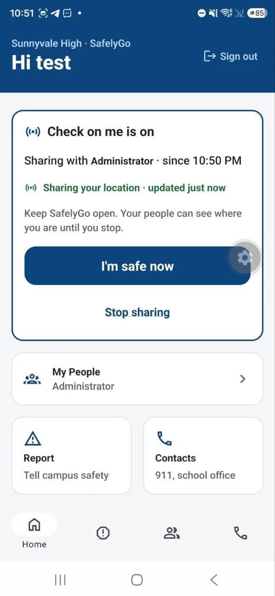
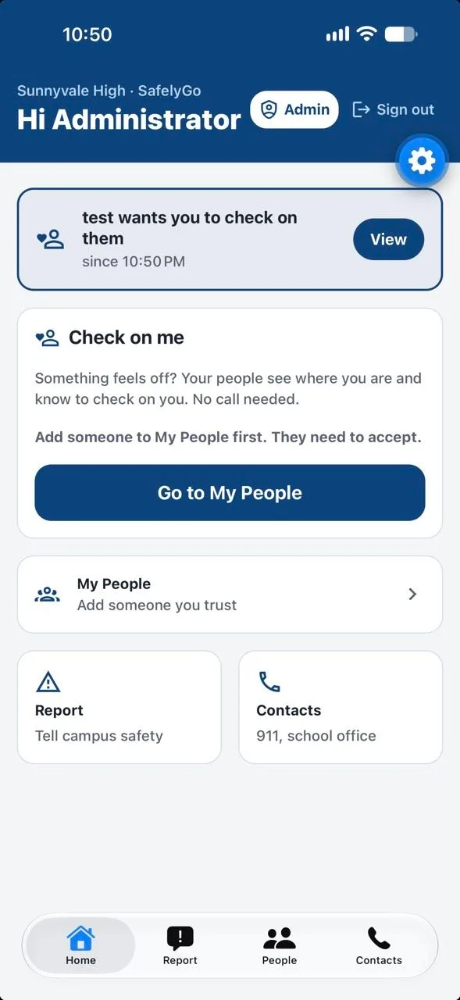
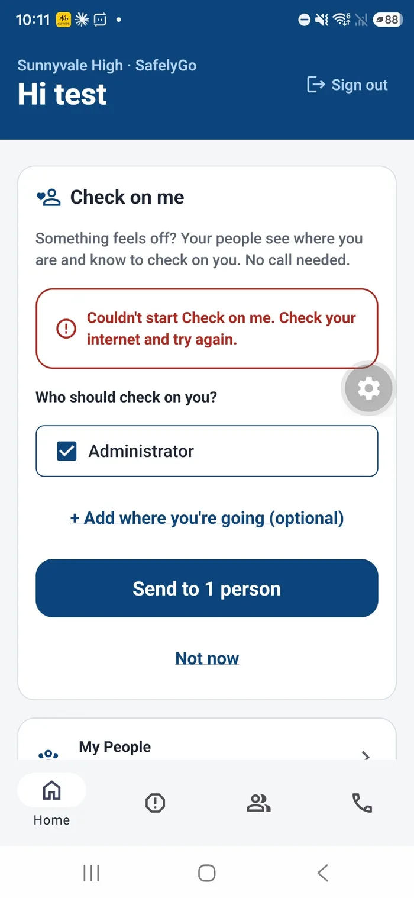
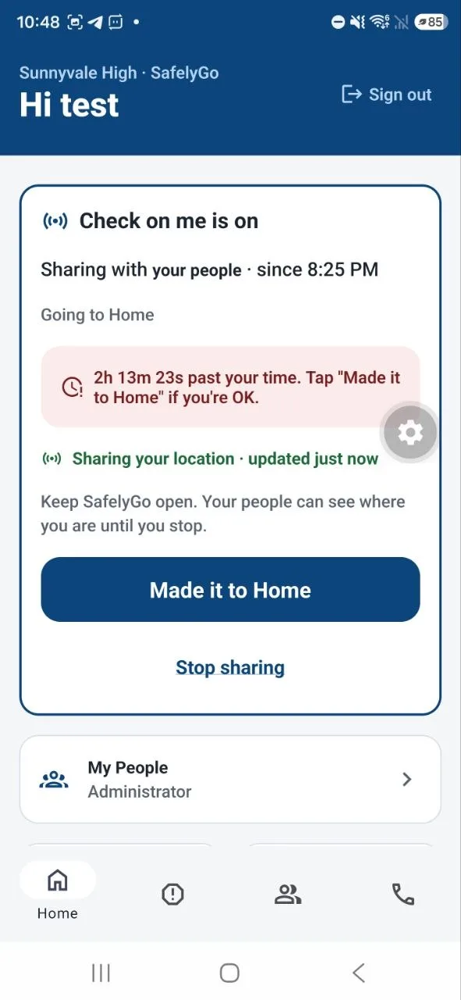

**What I built:**
In my [last post](/log/2026/11/15/safelygo-redesign-why/) I explained why I rethought the app.
This post is about building the new version and testing it.

**Check on me** is now the main feature:
1. Tap **Check on me**. Everyone in My People is already picked.
2. Tap **Send**. That's it. Nothing to type.
3. Your location is shared with the people you picked, and they get
   "test wants you to check on them". They see it on Home, or as a banner on any other screen.
4. When you tap **I'm safe now**, the location is erased and they see **"test is OK now."**

  <figure>
    
    <figcaption>Sender (Android)</figcaption>
  </figure>
  <figure>
    
    <figcaption>Receiver (iPhone)</figcaption>
  </figure>

**What changed under the hood:**
- **Choosing people.** A new table remembers who each Check on me was sent to.
  Only those people can see it. Being in someone's My People is not enough.
- **One safe way to start.** The app can't add rows by itself. It calls one database function,
  `start_check_on_me()`, which saves the request and its people together. It also checks that
  everyone picked is really connected to you.
- **My People works both ways.** Once someone accepts, either of you can send Check on me to the other.
  I kept the database tables and changed the *rules* so an accepted link counts in both directions.
- **Names.** The screens say "My People" and "Check on me", but the code still says
  `guardian` and `watch`. Renaming the database would have meant rewriting rules that already worked.
- **Removed:** the SOS button, the home map, and all the emoji and animal mascots. Everything uses line icons now.

One thing I learned: when two tables' security rules check *each other*, the database gets stuck
in a loop ("infinite recursion"). I fixed it by saving the sender's id in the people table too,
so its rule doesn't need to look back at the other table.

**How I tested it (two accounts, two phones, six rounds):**
Android was the student account (sender) and my iPhone was the admin account (receiver).
Each round I went all the way through: send → receive → end → send again.

**Round 1: "Couldn't start Check on me."**

I asked the server directly and it answered "could not find the function." I had forgotten
to run the new SQL file in Supabase. This was the same mistake I made with Watch Me.
Lesson: **the app updates when I reload, but the database only changes when I run the SQL.**

**Round 2: "Check on me is already on," but the card looked off.**
An old Watch Me test walk from earlier tonight was still running in the database.
It had no "sent to" list, so nobody could see it, and the app couldn't show it either.
Fix: if starting fails, the app now looks for the one that is already on and **shows it**,
so you can end it, instead of just showing an error.

**Round 3: it worked.** After stopping the old walk and sending again, the iPhone showed
"test wants you to check on them" right away, without refreshing.

**Round 4: three things felt wrong.**
- When the sender tapped "I'm safe now," the banner on the iPhone **just disappeared.**
  That's scary, not reassuring. Now it changes to a green **"test is OK now."**
- On the map screen, the ended state was a **gray box with an X.** Now it shows a big green check,
  the time it ended, and "Their location was erased for privacy."
- I removed the place and time inputs, because nobody types those when they're nervous.

**Round 5: the most important bug.**
I had the map screen open and saw "test is OK now." Then the Android phone sent a **new** Check on me,
and the iPhone screen didn't change at all. The map screen was stuck on the old request,
and the banner was hidden on every map screen. In real life, that friend would have been ignored.
Fix: if the request you're looking at has ended and the same person sends a new one,
the screen **switches to the new one** automatically. The banner is now hidden only on that same request's screen.

In this round I also made My People two-way, and tested both. ✅

**Round 6: design.**
- I asked myself if the main button should be red. I decided no. Red means "danger, 911",
  and Check on me should feel safe to press. It's now the only filled navy card on Home,
  with a white button. Red is saved for real emergencies.
- While you're sharing, a small green dot gently pulses. If your phone's "Reduce motion"
  setting is on, the dot stays still.
- The **Remove** button on each person was always visible, and I worried about tapping it by mistake.
  Now it only appears after you tap **Edit**, and it still asks "Are you sure?"

**What I learned:**
- Going all the way through (send, receive, end, *send again*) found a bug that a single test would never show.
- Error messages should help the person fix the problem. "Already on" with no way to end it didn't.
- "It disappeared" can feel worse than an alert. Endings need a message too.
- I still forget to run the SQL! Next time I'll put a big "Run this in Supabase" warning at the top of every new SQL file.

**Next step:**
Check on me part 2: **silent chat with buttons**, like "Someone is following me", "I'm lost", and
"Can't talk, text only", with quick answers like "Calling you now" and "Coming to you".
