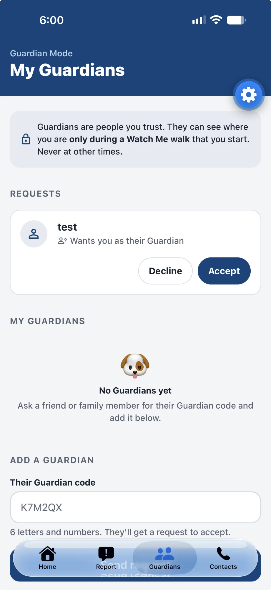
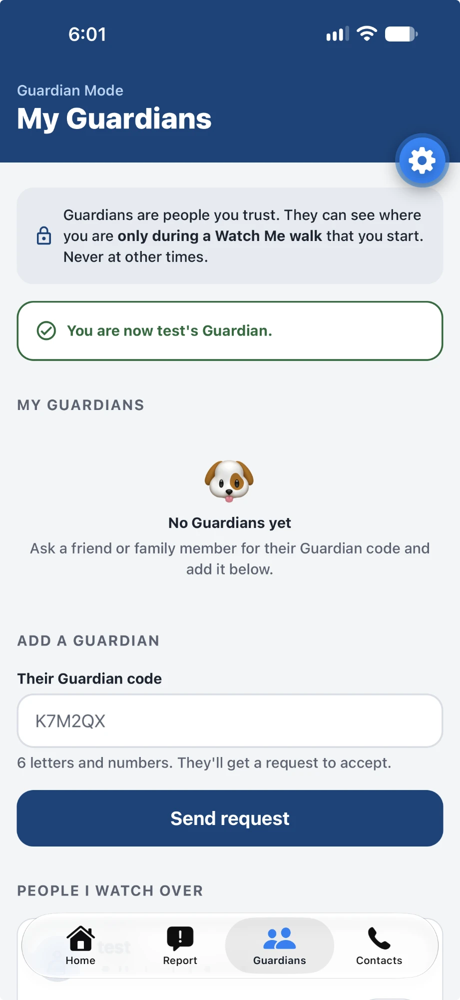
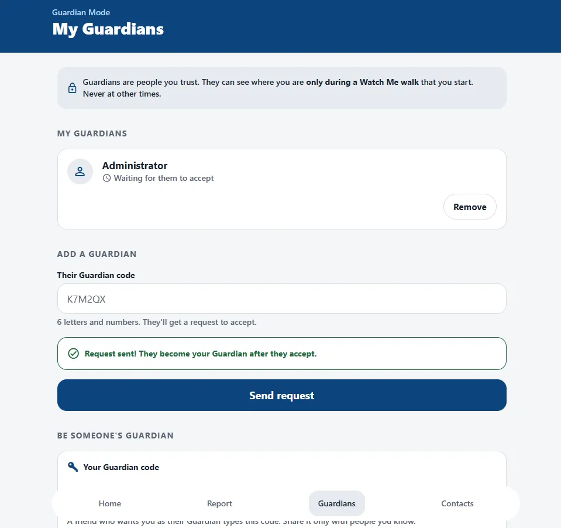

**What I built:**
Guardian Mode is the main feature of SafelyGo. You add friends or family as your **Guardians**.
Later, during a "Watch Me" walk, they can see where you are until you arrive.
I split it into three parts:

1. **Who are my Guardians?** Add, accept, remove. ✅ *(this post)*
2. **Watch Me:** set a destination and arrival time, and your Guardians see your live location.
3. **Alerts:** a Guardian is alerted if you're late or press SOS.

**Why a code instead of searching by email:**
My first idea was "type your friend's email to add them." But if the app lets you search by email,
anyone could find out whether a certain person uses the app. That's a privacy leak.

So every user gets a short **Guardian code** instead. It has 6 letters and numbers, and leaves out
look-alike characters like 0/O and 1/I/L so it's easy to read out loud. The flow:

1. Your friend tells you their code.
2. You type it and tap **Send request**.
3. Your friend sees the request and taps **Accept** (or Decline).
4. Either person can remove the link at any time.

Being someone's Guardian does **not** show their location.
Location is only shared during a Watch Me walk that *they* start.

  <figure>
    
    <figcaption>The request (phone)</figcaption>
  </figure>
  <figure>
    
    <figcaption>After Accept</figcaption>
  </figure>

**The database part (SQL + security):**
- `guardian_codes`: one code per user. Row Level Security lets you read **only your own** code.
  New users get a code automatically from a database trigger.
- `guardian_links`: who watches over whom, with a status of `pending` or `accepted`.
  - Only the two people in a link can see it.
  - Only the **Guardian** can accept it.
  - Either person can delete it.
- The app has **no permission to insert links directly.** The only way in is a database function,
  `add_guardian_by_code()`, which checks the code. It answers with one word (`added`, `not_found`,
  `self`, `already_added`, `too_many`), and the app turns that word into a friendly sentence.
- I kept the codes in their own table, not in the profile. That way, people who are linked can see each
  other's **name** but not each other's code.

**Code structure:**
I used the same patterns as the rest of the app. `GuardianRepository` only talks to the database.
`GuardianService` cleans up what you type (`k7m-2qx` → `K7M2QX`), checks it, and picks the message.
The screen only calls the service.

**How I tested it (two accounts, two devices):**
The admin account was on my phone, and the test account was in a web browser on my computer.

| # | What I did | Expected | Result |
|---|---|---|---|
| 1 | Send a request with the admin's code | "Request sent!", waiting | ✅ |
| 2 | Open Guardians on the other device | The request shows up | ✅ |
| 3 | Tap Accept | "You are now test's Guardian." | ✅ |
| 4 | Refresh the first device | Status changes to "Your Guardian" | ✅ |
| 5 | Send the same code again | Blocked: already on your list | ✅ |
| 6 | Type a wrong code | Blocked: no one has that code | ✅ |
| 7 | Type my own code | Blocked: that's your own code | ✅ |
| 8 | Remove, then confirm | Gone on both devices | ✅ |

**What went wrong / what surprised me:**
- I almost forgot test 7 (typing my own code). Rows 5 to 7 are the "should NOT work" tests,
  and they matter as much as the happy path.
- The example code in the empty box looked like real typed text. I changed it to `e.g. K7M2QX`.
- I didn't put screenshots of real Guardian codes in this post, even test ones.

**What I learned:**
- Privacy can be designed in from the start: no search, consent from both sides, and easy removal.
- If the app can't do something directly (no INSERT permission), a modified app can't do it either.

**Next step:**
Watch Me, part 2: start a walk and share live location with Guardians only during that walk.
