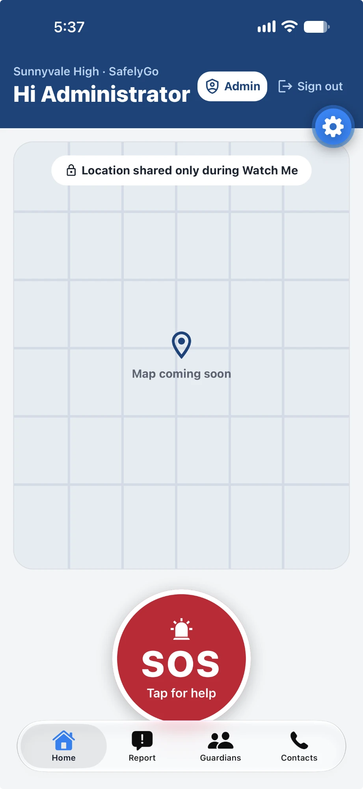
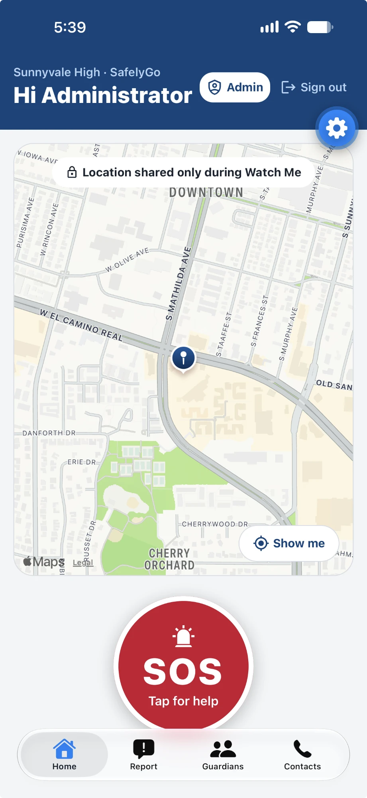
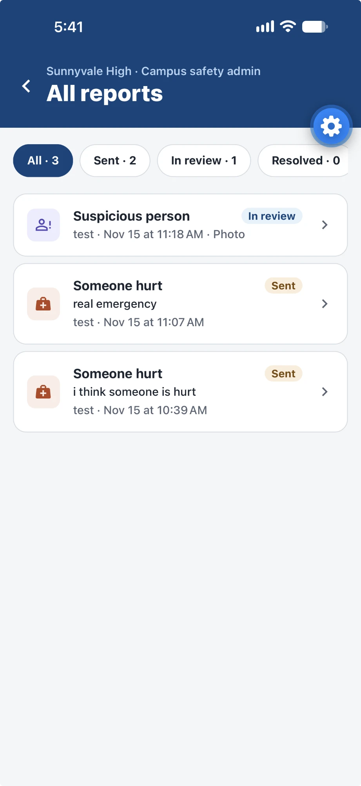

**What I built:**
The Home screen had a fake gray grid that said "Map coming soon." Now it's a real map.
This also covers one of the BPA rules: the app has to use at least one third-party API.
I used `react-native-maps`, which shows Apple Maps on iPhone and Google Maps on Android.

- **Home:** the map starts on the campus. A **Show me** button finds where you are and puts a pin there.
- **Admin report page:** a small map shows where the report was sent from.
  The pin uses the report type's color (orange for "Someone hurt").

**Privacy by design:**
- The map never turns on location tracking by itself.
- **Show me** reads your location **once**, when you tap it. It's only shown on your own screen.
  It is not saved and not sent anywhere.
- Location is only shared during a Watch Me session, and the map says so at the top.
- The campus pin is a **demo location** in a public city center. It's not a real school.

**Phone vs. web:**
`react-native-maps` doesn't run in a web browser. So I made two files:
`safety-map.tsx` for phones and `safety-map.web.tsx` for the web, which shows a free OpenStreetMap map.
Both follow the same "contract" (the same props), so a screen only writes `<SafetyMap />`,
and Expo picks the right file for the device.

**The bug: "the map is still not there!"**
I restarted Expo, opened the app, and saw the old gray grid and "Map coming soon" again.

  <figure>
    
    <figcaption>What my phone showed</figcaption>
  </figure>
  <figure>
    
    <figcaption>After reloading</figcaption>
  </figure>

Here's how I found the cause, one step at a time:
1. **My code:** I searched for "Map coming soon." It wasn't in the code anymore. The Home screen was already using the new map.
2. **The server:** I downloaded the code that the Expo server on my computer sends to the phone.
   The new map text was in it. So the server was sending the new version.
3. **The phone:** That left only the phone. Expo Go was still showing the **old code it had saved earlier**.
   I had restarted the server on my computer, but the app on my phone never reloaded.

**The fix:** shake the phone and tap **Reload**
(or fully close Expo Go and open the project again). The real map showed up right away.

**My test table (admin account):**

| # | What I did | Expected | Result |
|---|---|---|---|
| 1 | Open Home | Real map, campus pin, privacy note | ✅ (after Reload) |
| 2 | Tap **Show me** | Map moves to me, button changes to "Update" | ✅ |
| 3 | Open the admin list | Small pill-shaped filter buttons | ✅ (the bug from my last post is fixed) |
| 4 | Open a report | Small map with an orange pin under the note | ✅ |

I didn't post screenshots of tests 2 and 4, because they show a real location.

**What I learned:**
- When "nothing changed," check each step in order: **my code → what the server sends → what the phone shows.**
  The problem is at the first step where the new code is missing.
- A third-party API can be added without sharing any extra data, if you decide *when* location is read.

**Next step:**
Build Guardian Mode: add a Guardian and start a "Watch Me" session.
