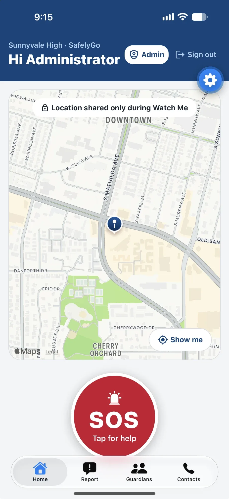
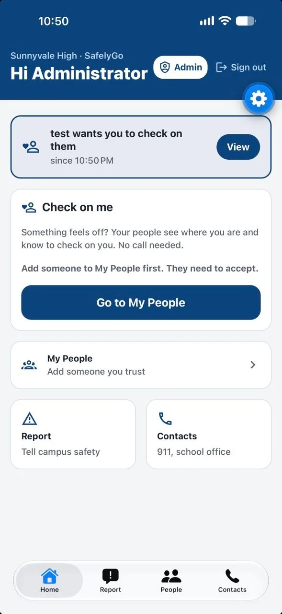

**What happened:**
By tonight, every feature of my plan was working: a big red SOS button on the home screen,
Guardians, and Watch Me (live location until you arrive). I tested it with two phones and
everything passed. But when I put the two phones side by side, something felt wrong.
The more I asked "would people really use this?", the more things I ended up changing.

This post is about **why** I changed it. The next post is about how I built and tested the new version.

  <figure>
    
    <figcaption>Before: map + big SOS</figcaption>
  </figure>
  <figure>
    
    <figcaption>After: Check on me</figcaption>
  </figure>

**The questions I asked myself (in order):**

1. **"It looks low quality."** On the iPhone, the SOS button was hidden behind the tab bar.
   On Android, there was empty space under it. At first I thought it was a layout problem,
   but the real problem was the button itself.

2. **"Would anyone actually press it?"** If I were in real danger, would I open an app and look
   for a button? No. I would just call 911. Phones already have 911 and an emergency SOS
   on the side button. Copying that doesn't add anything.

3. **"What about calling 911 *and* alerting friends at the same time?"** That idea came up too.
   But who thinks, "I'll call 911, and I should also notify my Guardians"? That's the logic of
   the person building the app, not what a person in trouble actually does.

4. **So when does this app really help?** I found two moments:
   - When something feels **off but isn't a 911 emergency**, like someone following you on a dark street.
   - When you **can't make a call**, because someone is next to you or you can't make noise.

   So the core became: **quietly bring your people in, without a phone call, while they see where you are.**

5. **The names didn't feel right.** "Guardian" sounds like a *legal guardian*. Nobody calls their
   friend that. It became **My People**. "Watch Me" sounded like "look at me!" so I changed it too.
   I went through a few options:
   - "I feel unsafe" worries the other person, and there can be many reasons.
   - "Call me" decides *how* they should help.
   - **"Check on me"** doesn't need a reason, and the other person picks how to reach out. That's the one.

6. **Typing a place and a time?** When you're nervous, you won't type "Library, 15 minutes."
   So now there is **nothing to type**. You pick your people (everyone is picked already) and press Send.

7. **Cute animals don't fit.** I had planned dog and cat mascots. But this app is for tense moments,
   so animal emoji felt wrong. Everything now uses simple line icons.

8. **One-way links felt strange.** If I add a friend, they could check on me, but I couldn't check on them.
   Friends and family look out for *each other*, so now an accepted link works **both ways**.

9. **Silence after "I'm OK" is scary.** When my friend ended a Check on me, the alert on my screen just
   disappeared, and the map turned gray with an X. That made me *more* worried. Now it changes to
   a calm message: **"test is OK now."**

10. **Should the main button be red?** I thought red would get attention. But red means "danger, 911."
    People would hesitate to press it, and the person receiving it would panic. So red is saved for
    real emergencies, and Check on me is the only filled navy card on the home screen.

11. **A Remove button that's always there** felt like I could delete someone by accident.
    Now it only shows after you tap **Edit**.

**Before and after:**

| | Before | After |
|---|---|---|
| Main idea | Big SOS (911) | **Check on me**: reach your people without a call |
| People | Guardians (one way) | **My People** (both ways) |
| Sharing location | Watch Me (place + time required) | Nothing to type: pick people, Send |
| When it ends | The alert just disappears | "test is OK now" |
| 911 | Big button on Home | One tap in Contacts |
| Pictures | Dog and cat mascots | Line icons only |
| Red | SOS button | Only for real emergencies |

**What's next (from the same idea):**
1. ✅ Check on me: pick people, share location, they get a request
2. **Silent chat with buttons**, like "Someone is following me", "I'm lost", "Can't talk, text only".
   They can answer "I see you on the map", "Calling you now", "Coming to you".
3. **Emergency step:** Call 911 or the school office, or let a friend call 911 for you.
   They can, because they see where you are.

**What I learned:**
- A feature that *works* isn't the same as a feature people would *use*.
  All my tests passed, and I still had to rethink it.
- I should judge ideas by what a real person would do in that moment, not by what sounds good to build.
- One word can change how a feature feels. "I feel unsafe" and "Check on me" can be the same button,
  but people react to them very differently.
- Every extra thing to type makes it less likely someone uses the app when it matters.
- Colors have meaning. If red is everywhere, it stops meaning "emergency."
- Changing direction didn't mean starting over. About 80% of what I built (links, location sharing,
  erasing location at the end, the live map, real-time updates) is still used.

**How it felt:**
When I decided to change the plan, it felt like all my work so far had been for nothing.
But I believed the new direction was right, so I couldn't just stick with the old one.
Changing the plan was something I couldn't avoid. Still, the change itself was really stressful.
It was the right direction, but it was hard.
