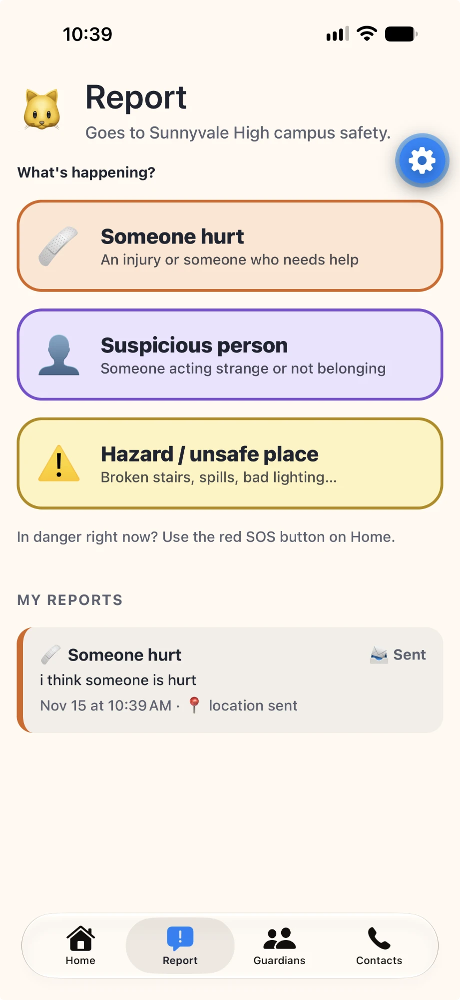

**What I did:**
I built the Report tab. A student picks one of three big tiles:
🩹 Someone hurt (orange), 👤 Suspicious person (purple), or ⚠️ Hazard / unsafe place (yellow).
Then they can add a short note, the app adds their location, and they tap Send.
The report goes to the school's campus safety staff, and the student can see it under "My reports"
with its status (Sent → In review → Resolved).

I kept it to three categories on purpose. When something is happening, choosing should be fast.
If someone is in danger right now, the screen points them to the red SOS button instead.



*This is the first version. Later the same day I changed the design. See the next post.*

**Location, but only when it's needed:**
- The app asks for location only "while using the app," never in the background.
- It reads the location once, at the moment you send a report.
- If you say no, you can still send the report without it.
- The screen never shows the exact coordinates, just "Location added (within about 20 m)."
  That way my screenshots don't show where I am.

**The SQL part: who sent this report?**
The most important rule: the app should not be able to lie about who sent a report.
So the database fills that in by itself, from the login:

```sql
reporter_id uuid not null default auth.uid() references auth.users (id) on delete cascade,
```

Then I only gave the app permission to write the columns a student should fill in.
`reporter_id` and `status` are not on the list, so the database refuses them if the app tries:

```sql
grant insert (category, note, latitude, longitude, location_accuracy, photo_path, notify_guardians)
  on public.reports to authenticated;
```

Row Level Security decides who can see what:

```sql
-- Students see only their own reports. Admins see all of them.
using (reporter_id = (select auth.uid()) or (select public.is_admin()))

-- You can only send a report as yourself, and it always starts as 'new'.
with check (reporter_id = (select auth.uid()) and status = 'new')
```

There is also no delete rule at all. That means nobody can delete a report from the app.
These are safety records, so I want them to stay.

A few smaller rules I learned:
- `check ((latitude is null) = (longitude is null))` means latitude and longitude come together, or not at all.
- An index on `(reporter_id, created_at desc)` helps the database find "my reports, newest first" quickly.
  It works like the index at the back of a book.

**What went wrong / what surprised me:**
- After installing the location package, I had to restart the development server.
  New native packages don't load until you do.
- The linter didn't allow a plain `'` inside screen text (like "What's happening?").
  I had to write it as `&apos;`.

**What I learned:**
- Don't trust the app to say who the user is. Let the database decide from the login.
- Giving permission column by column is a simple way to stop fake data.
- Ask for the least amount of location you need, for the shortest time.

**Next step:**
Letting students attach a photo to a report, then the admin screen where campus safety staff can review reports.
