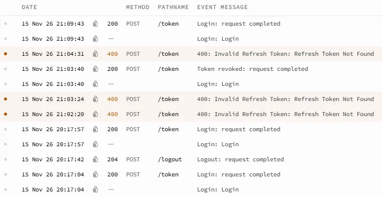

**What happened:**
While I was testing [Watch Me](/log/2026/11/15/safelygo-watch-me/), I used two phones:
an Android phone signed in as the student test account, and my iPhone signed in as the admin.
Everything worked. Then, out of nowhere, the iPhone was **logged out**. I hadn't touched it.
The Android phone was still logged in.

**My first guess (and why I doubted it):**
In our code, the Sign out button called `signOut()`. In Supabase, the default for that function is
**`global`**, which means "sign this account out on **every** device." Our code comment said
"signs out on this device," but the real behavior was different.

So I changed it to sign out only on the current device:

```ts
await this.client.auth.signOut({ scope: 'local' });
```

But then I thought: I never signed out of the admin account anywhere. So maybe that wasn't the cause.
Another possible cause was a security feature called "refresh token reuse detection."
If the app tries to use an old login key, Supabase thinks it might be stolen and cancels the login.

**Reading the server logs:**
Instead of guessing, I opened Supabase → Logs → Auth and looked at the time it happened.



Reading from the bottom (oldest) to the top:

| Time | Log | What it means |
|---|---|---|
| 20:17:04 | Login | I signed in on the Android phone |
| 20:17:42 | **/logout** | Someone pressed Sign out |
| 20:17:57 | Login | Signed in again |
| 21:02:20 | **Refresh Token Not Found** | The iPhone tried to renew its login, and its key was already gone |
| 21:03 to 21:09 | Login | Me signing back in on the iPhone |

**The clue was in the exact error message:**
- If it were the reuse problem, the error would say **"Already Used."**
- It said **"Not Found."** That means the key had been **deleted**.

The only thing that deletes keys like that is the `/logout` at 20:17:42.

**Then I remembered:**
When I first set up the Android phone, I signed in as the **admin by mistake**.
I noticed it wasn't the student account, pressed Sign out, and signed in as the student.
Because Sign out was `global`, that one tap also cancelled the admin login **on my iPhone**.

**Why did it take 45 minutes?**
A Supabase login has two parts:
- an **access token** (like a pass), which works for about 1 hour
- a **refresh token** (like a key), which gets a new pass when the old one runs out

The iPhone already had a pass, so it kept working during all my tests.
When the pass ran out at 21:02, it tried to use its key to get a new one.
But the key had been deleted 45 minutes earlier, so it was logged out.
That's why it looked like it happened "by itself."

**The fix:**
The one-line change above. Now Sign out only signs out the device you tap it on,
and the code comment and the real behavior finally match.
It was a real bug after all. My first guess was right, but I only *knew* it after reading the logs.

**What I learned:**
- Check a library function's **default settings**. "Sign out" can mean more than you think.
- When something weird happens, the **server logs** show what really happened, not just what the screen shows.
- Small details in an error message ("Not Found" vs. "Already Used") can tell two causes apart.
- A bug can show up a long time after the thing that caused it. Here it was 45 minutes later.
