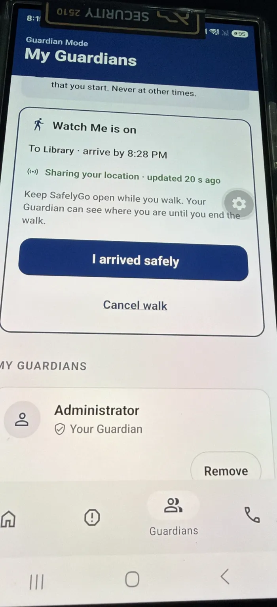
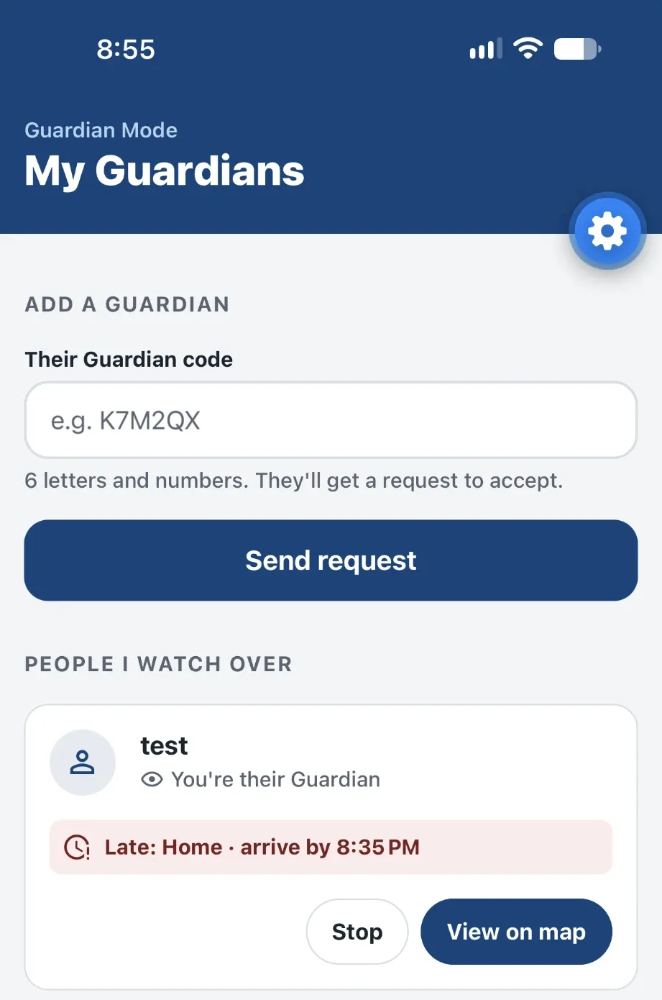
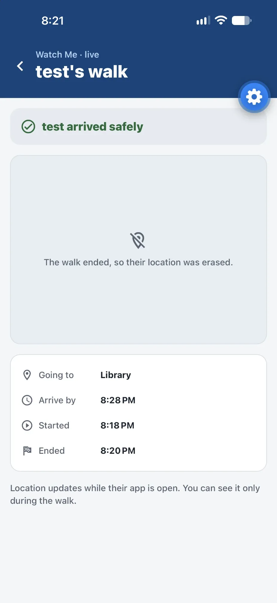
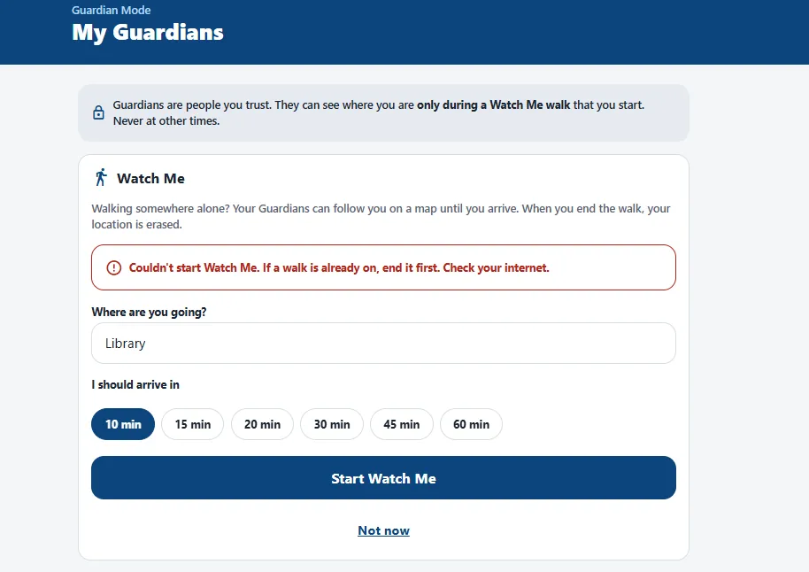
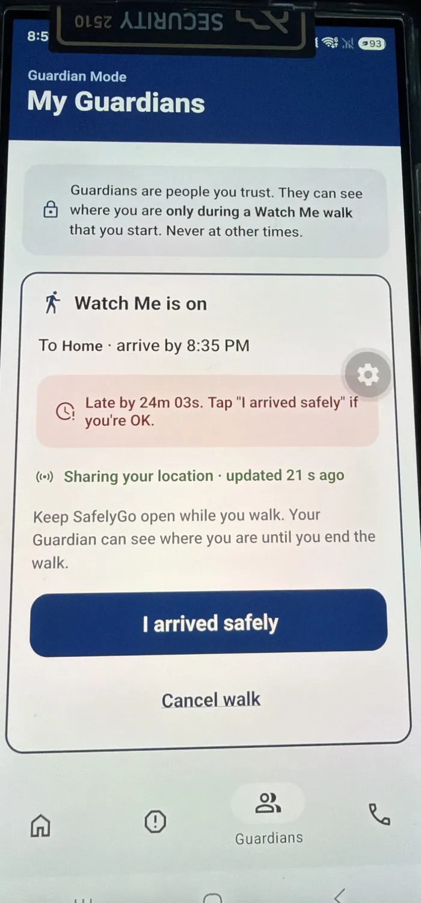

**What I built:**
This is part 2 of Guardian Mode. In [part 1](/log/2026/11/15/safelygo-guardians-part1/) I made it possible
to add Guardians with a code. Now those Guardians can actually watch over you:

1. You type where you're going (like "Library") and pick when you should arrive (10 to 60 minutes).
2. You tap **Start Watch Me**.
3. While the app is open, your phone sends your location about every **15 seconds**.
4. Your Guardian sees "On a walk: Library" and can tap **View on map** to follow you live.
5. When you tap **I arrived safely** (or Cancel), the walk ends and your location is **erased**.

If you are past your arrival time, both screens show a red **Late** warning,
and the Guardian is told to try calling you, or call 911 if they think you're in danger.

  <figure>
    
    <figcaption>The walker's phone</figcaption>
  </figure>
  <figure>
    
    <figcaption>The Guardian's list (late)</figcaption>
  </figure>

**Privacy by design:**
A live location is the most private thing this app touches, so I made the **database** enforce the rules,
not just the app.

- Location is sent **only during a walk you start.** Never at other times.
- Each walk keeps **only the latest point.** New points overwrite the old one, so there is no location history.
- When the walk ends, a **database trigger erases the location.** Even if the app forgot, the database does it.
- The database writes the "last update" time itself, so a phone can't fake it.
- Only you and your **accepted** Guardians can see the walk (Row Level Security).
  Guardians can still see "arrived safely" for 1 hour, and then the walk disappears for them too.
- One walk at a time, and the arrival time can be at most 3 hours away.

*This is the Guardian's screen right after I tapped "I arrived safely" on the other phone. I didn't refresh it.
It changed by itself, and the map is gone because the location was really deleted from the database.*

**How the screens update by themselves:**
The Guardian's screen uses the **Observer pattern** through Supabase Realtime.
It subscribes to changes on that one walk. When the walker's phone saves a new point or ends the walk,
the screen gets a signal and reloads. Realtime still follows Row Level Security,
so people who aren't Guardians don't even get the signal.

**Code structure:**
- `WatchSessionRepository` only talks to the database (Repository pattern).
- `WatchService` checks what you typed, starts and ends walks, and sends at most one point every 15 seconds,
  which saves battery and data (Service pattern).
- `WatchMeProvider` sits **above the tabs**. So if you switch to the Home tab during a walk,
  sharing keeps going. I tested that too.

**How I tested it (two phones):**
The walker had to be a phone with real GPS. My computer's location settings were confusing,
so I used an old Android phone as the walker (test account) and my iPhone as the Guardian (admin account).
The Android camera is covered by a sticker, so I couldn't scan the Expo QR code.
Instead I typed the address into Expo Go by hand (**Enter URL manually**).
The QR code is just that address turned into a picture.

| # | What I did | Expected | Result |
|---|---|---|---|
| 1 | Start a walk to "Library", 10 min | Watch Me is on, sharing | ✅ |
| 2 | Open Guardians on the iPhone | "On a walk: Library" | ✅ |
| 3 | View on map | Pin on the map, time left | ✅ |
| 4 | Tap "I arrived safely" | Walk ends, location erased | ✅ |
| 5 | Wait on the iPhone (no refresh) | "test arrived safely" by itself | ✅ |
| 6 | Wait past the arrival time | Late warning on both phones | ✅ (found 2 bugs) |
| 7 | Stand still during a walk | "Last update" stays fresh | ✅ after fix |
| 8 | Switch tabs during a walk | Sharing doesn't stop | ✅ |

I'm not posting the live map screenshots, because they show a real location.

**What went wrong (4 bugs) and how I fixed them:**

**1. "Couldn't start Watch Me."**
The first time I tapped Start, it failed. The app only shows one friendly sentence,
so the screen didn't tell me the real reason.

We asked the server directly, and it answered `PGRST205: Could not find the table 'public.watch_sessions'`.
The code was fine. I just hadn't run the new SQL file in Supabase yet.
Lesson: when something fails, check in order: my code → what the server sends back → what the phone shows.

**2. "You're 0 min past your arrival time."**
A few seconds after the arrival time, the app said I was late by **0** minutes.
The time was being *rounded*, so 20 seconds late became 0.
Fix: one function, `minutesLate()`, that rounds **up** and shows at least 1.
Both screens use the same function, so they always agree.

**3. The Guardian saw "Last update 11 min ago", but my phone said "updated 18 s ago".**
This one was the most important. My phone *was* sending its location every 15 seconds.
But the database only wrote down the time when the **coordinates changed**,
and I was standing still, so the coordinates stayed the same.
A Guardian could think "no news for 11 minutes, is their phone off?"
Fix: a small SQL change so **every** save writes the time. Now "Last update" means
"when the phone last checked in." I only found this because I compared **two screens side by side**
and the numbers didn't match.

**4. "Late by 20:17" looked like a clock time.**
While testing I felt that "8 min left" was too vague. I couldn't tell if someone was just late or almost 2 minutes late.
So I changed it to a countdown with minutes and seconds. But my first version showed `20:17`,
which looks like 8:17 PM, right next to "arrive by 8:35 PM."
Fix: add units, so it says **20m 17s** (or `1h 02m 09s` for long walks).

Two small things I also thought about for the countdown:
- **Screen readers:** the numbers change every second, but a screen reader only hears whole minutes
  ("about 8 minutes"), so it doesn't read out every tick.
- **The map doesn't flicker:** only the small status banner redraws every second, not the map under it.

**What I learned:**
- Privacy rules are safest in the database (triggers, Row Level Security), not only in the app.
- Testing with two devices finds bugs that one screen never shows, like #3.
- Every bug was fixed in **one place** (one function or one SQL trigger), because the logic wasn't copied around.

**Limits (for now):**
Sharing only works while the app is open. Expo Go can't use location in the background,
so the card says "Keep SafelyGo open while you walk."

**Next step:**
Guardian Mode part 3: end the walk automatically on arrival, alert Guardians when someone is late, and SOS → Guardians + school.
