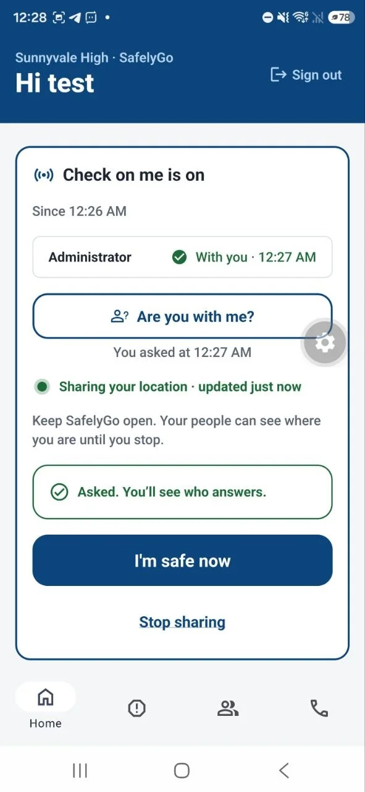
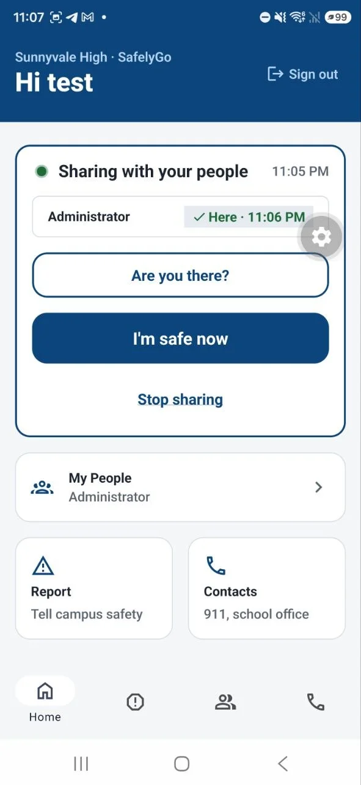
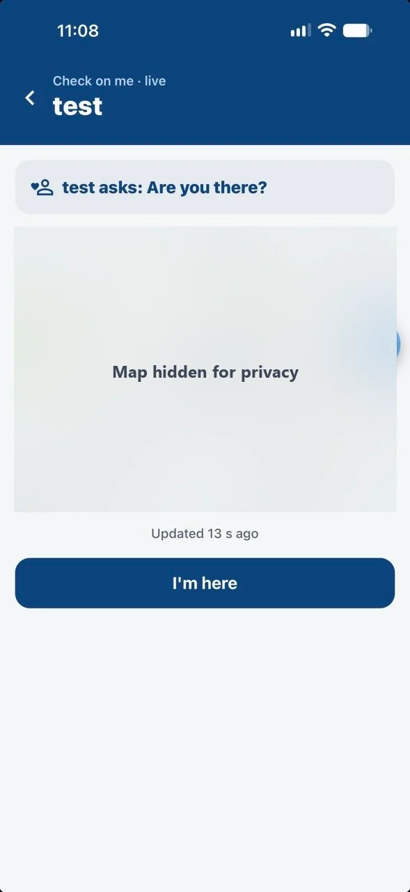

**The problem:**
After [Check on me part 1](/log/2026/11/15/safelygo-check-on-me/), you could send a Check on me
and your people could see where you are. But the sender had no idea if anyone actually *saw* it.
When you're nervous, "Did anyone even see this?" is the scariest part.

**What I first planned (and dropped):**
My plan was a "silent chat" with ready-made buttons, like "Someone is following me" or "I'm lost".
But there are endless situations, and a few buttons can't cover them. A long list is hard to use
when you're scared. I also thought about a small text chat, but if people want to type,
they'll use their Messages app. It's what they already use, and it notifies them even when the phone is locked.
So I dropped both.

**What I built instead (one button each side):**
- **Seen:** when one of your people opens the live view, your screen shows "Seen". They don't have to do anything.
- **Are you there?:** the sender can ask again at any time.
- **I'm here:** the other person answers with one button.

An answer only counts if it came **after the latest "Are you there?"**, so "Here" always means
"still here *right now*", not "I was here 30 minutes ago."
The database writes every time, not the phone, so nobody can fake it.

**Changing the words:**
My first version said "Are you with me?" and "I'm with you". When I tested it, "I'm with you" felt a little creepy,
like someone is always watching you. "Are you there?" / "I'm here" is what people say on a phone call.
It's shorter and sounds like "I can be reached," not "I'm watching you."

**Making the screen less busy:**
The first version worked, but it had too much text. The card had about ten lines: a title, a "since" time,
each person's status, "You asked at…", "Keep SafelyGo open…", a green "Asked" box, and two buttons.

  <figure>
    
    <figcaption>Before: about ten lines</figcaption>
  </figure>
  <figure>
    
    <figcaption>After: five things</figcaption>
  </figure>

I used one rule: **one line = one piece of information.** I joined the title and the sharing line into one line
with a pulsing green dot. Each person got a small chip (Sent → Seen → Here), and I removed every line
that said the same thing twice.

*The receiver's side: one status line, the map (hidden here because it shows a real location), and one button.*

**How I tested it:**
| What I did | Result |
|---|---|
| Sender: Check on me | "Administrator · Sent" ✅ |
| Receiver: open it | Sender's chip changes to "Seen" by itself ✅ |
| Receiver: I'm here | Sender: "✓ Here · 11:06 PM" ✅ |
| Sender: Are you there? | Receiver's screen: "test asks: Are you there?" ✅ |
| Receiver: I'm here again | Sender: "✓ Here · 11:09 PM" ✅ |

**What I learned:**
- The most useful feature was the simplest one: letting the sender know someone saw it.
- Words matter. "I'm with you" and "I'm here" do the same thing, but they feel very different.
- A screen people read in a tense moment should say each thing only once.

**Next step:**
Make the whole thing look like a conversation, so it's clear *who* you're talking with,
and add an "I need help" button. That's my [next post](/log/2026/11/16/safelygo-thread-and-help/).
