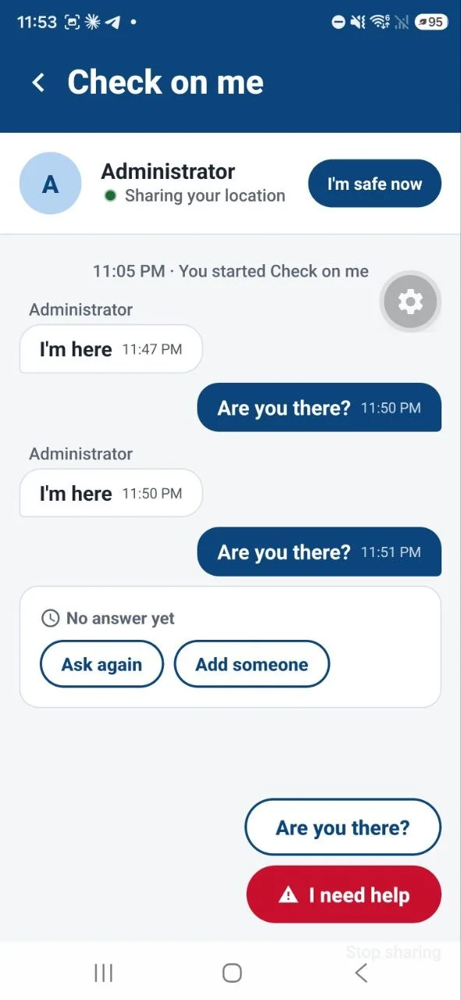
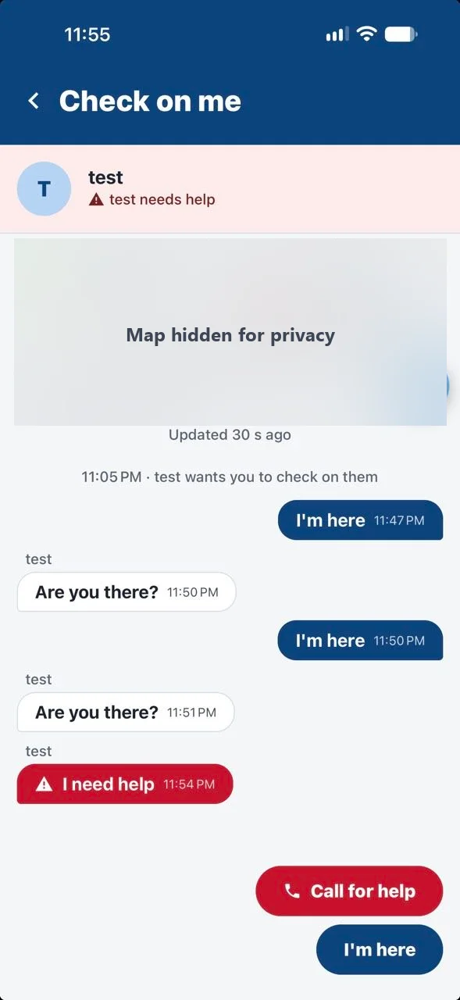
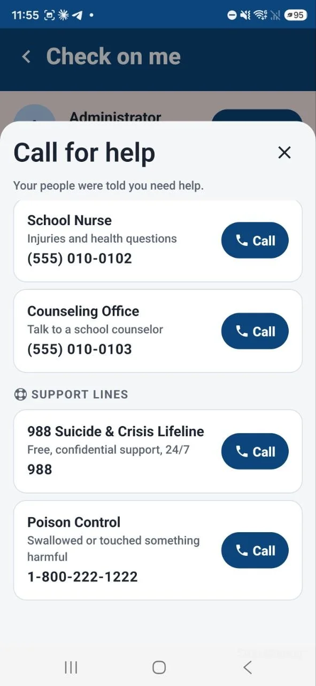

**Where I started today:**
In my [last post](/log/2026/11/16/safelygo-check-on-me-part2/), Check on me could share your location
with the people you picked, and they could answer "I'm here" when you asked "Are you there?".
It worked on both phones. But when I looked at the screens again, a few things bothered me:

- I couldn't tell **who** I was talking with at a glance.
- The status ("Sent", "Seen", "Here") was small and easy to miss.
- What if the other person is busy and never answers?
- What should happen when it's more serious than "check on me"?

**Change 1: a conversation, not a status card**
Now every Check on me opens a screen that looks like a chat:
- A **big circle with the person's initial** at the top, so it's obvious who this is with.
- Everything that happens shows up **in time order**, like messages. My lines are on the right,
  theirs are on the left, and small gray lines show things like "Seen by Administrator".
- But **nobody types**. Each line comes from a button. I decided not to build real texting,
  because people already text in their Messages app, and it notifies them even when the phone is locked.
  SafelyGo only adds what Messages can't do: your live location and one-tap "Are you there?" / "I'm here".

  <figure>
    
    <figcaption>Sender (first version)</figcaption>
  </figure>
  <figure>
    
    <figcaption>Receiver after "I need help"</figcaption>
  </figure>

(I hid the map in the screenshot because it shows a real location.)

**Change 2: what if nobody answers?**
My first idea was some kind of alarm. But an alarm would go off in class, and in Expo Go
it can't even ring while the app is closed. It would also make the app more complicated.
So now, if "Are you there?" gets no answer for 2 minutes, the conversation just shows one gray line:
**"No answer yet."** It's a fact, not a siren. I had to accept that sometimes the conversation is
one-way for a while. From there you can ask again, or go to the next step.

I first added "Ask again" and "Add someone" buttons there, but I removed them.
In a tense moment, fewer buttons is better, and "Are you there?" was already at the bottom.

**Change 3: "I need help"**
I thought about a "Call 911 for me" button, or a more serious message like "I feel unsafe".
I combined them into one red button: **I need help**.
- Your people see a red "I need help" right away, and the top of their screen turns red.
- You get a **Call for help** list: 911 first, then the school office, school nurse, counseling,
  and support lines like 988. Not every situation is a 911 situation, so you choose.
- The people checking on you get a **Call for help** button too. They can see where you are,
  so they can call for you and tell the operator your location.

Red is only used for this. Everything else stays calm navy, so red really means "help."

**Change 4: three tabs instead of four**
The old tabs were Home, Report, People, and Contacts. They felt like separate features, not one app.
I grouped them by *who you're reaching*:

| Tab | What's in it |
|---|---|
| **Check-ins** | Check on me, and requests from your people |
| **People** | Your people and your invite code |
| **Campus** | Call for help (911, school, support lines) and Report a concern |

The "Call for help" list in Campus is the **same list** that opens from "I need help",
so it's already familiar when you need it fast.

**Small fixes from testing:**
- **A crash on the sender's phone only.** The sender's screen listened for updates in two places
  with the *same* channel name, and Supabase refused the second one. The receiver's phone only had
  one listener, so it worked there. Lesson: test both sides.
- **The map was small,** but the conversation needs the space. Now there's an **Enlarge** button
  for a full-screen live map. (A button, not tapping the map, because the map uses taps and drags itself.)
- **Buttons looked like messages.** "I'm here" was a navy rounded shape, just like my own bubbles.
  Now the buttons sit in their own panel ("Tap to send"), with squarer corners, an icon, and a send arrow.
  They're all the same width, and they all end with the same arrow.
- **"Stop sharing" was hidden** under Android's navigation bar. I added the phone's safe-area space.

**What I learned:**
- If two things look alike, people read them as the same thing. Buttons and messages need to differ
  in place, shape, and color.
- Small details like matching arrows and equal widths make a screen feel calm and organized.
- In an emergency app, fewer choices is better. Every button I removed made the screen easier to use.

**Next step:**
Put the web version online (that will be my submission link), show "I need help" records to
campus safety staff in the admin panel, and build the Android app.
