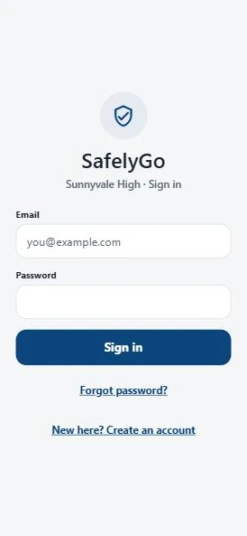

**What I did:**
SafelyGo now has a real web address that anyone can open in a browser, on an iPhone,
an Android phone, or a computer. This will be my submission link for the competition.
(I'm not posting the address here yet. I'll share it with the judges first.)

**How it went online (Expo's EAS Hosting, free):**
1. **Log in to Expo.** My computer was already logged in from when I set up Expo Go, so nothing to do.
2. **Link the project** to my Expo account (`eas init`). This adds a project ID to the app's settings.
   It isn't a secret.
3. **Build the web version** (`npx expo export -p web`). This makes the website files in a `dist` folder.
4. **Check for secret keys before uploading.** My search found the words `sb_secret_` in the built files,
   which looked scary at first. But when I read the text around it, it was the Supabase library's own code
   *checking* whether a key starts with `sb_secret_`. It wasn't an actual key, and my app doesn't even have one.
   Lesson: when a search finds something, read the lines around it before deciding what it means.
5. **Deploy** (`eas deploy --prod`). A few seconds later the site was live, and the sign-in page loaded with no errors.
6. Next time it's one command: `npm run deploy:web`.

**Fixing "Forgot password?" on phones:**
Account recovery is a required feature. It worked on the computer, but not from a phone.
The reset email needs an address to send you back to. In Expo Go, that address starts with `exp://`
and my computer's network address, and Supabase rejects that kind of address.
Now that I have a real website, phones send you back to the website's reset page.
You choose a new password in the browser, then sign in on the phone.
(I still need to add the new address in Supabase's settings and test it.)

**Can anyone get in?**
Anyone with the link can **open** the site. That's on purpose, because judges need to try it
without installing anything. But opening the site and *seeing other people's information*
are very different things:

| Anyone can… | But the database rules (Row Level Security) make sure that… |
|---|---|
| Open the sign-in page | You only see someone's location if you're connected, they started Check on me, **and** they picked you |
| Create an account | You only see your own reports. Only campus safety staff (admins) see all reports |
| | Nobody becomes an admin by signing up. That can only be changed directly in the database |
| | Nobody can add you to their people without **your invite code** and **your OK** |
| | The only key in the website is the public one, and my code repository is private |

**Things I'm still thinking about:**
- Anyone can create an account. That's fine for the competition, but a real school version could
  require email confirmation or only allow school email addresses.
- Search engines might list the sign-in page. One line of code can ask them not to.
- I'll make a separate **demo account for judges**, so I never have to share my test accounts.

**What I learned:**
- A public link is not the same as public data. The security is in the database rules, not in hiding the link.
- Check what you upload before you upload it, and read search results carefully before panicking.
- Hosting gave me a real web address, which also fixed a problem that seemed unrelated (password reset on phones).
