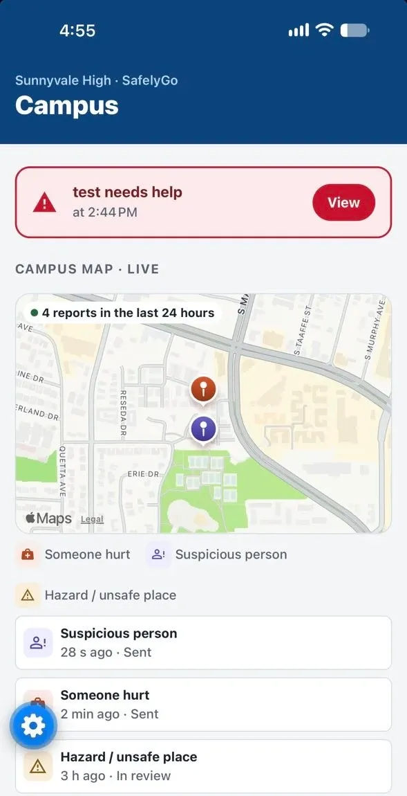
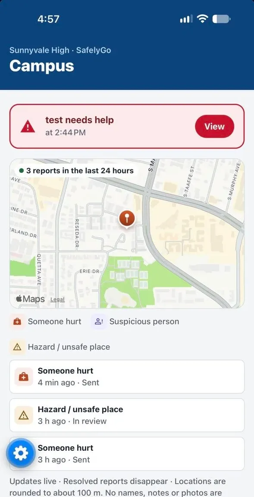

**Why build a map at all?**
The competition topic asks for a way to "view a live campus safety map". At first I wasn't sure it
made sense. There are already great map apps. Why would a student open a map inside SafelyGo?

The answer: Google Maps doesn't know what *our students* reported. It doesn't know the stairs by the
gym are broken, or that someone saw a suspicious person near the parking lot 20 minutes ago.
So the SafelyGo map shows **recent reports as pins**, so you can see where something is going on and
go another way. When campus safety marks a report as resolved, its pin goes away.

**What it looks like**

  <figure>
    
    <figcaption>A new report shows up in seconds</figcaption>
  </figure>
  <figure>
    
    <figcaption>Resolved, so the pin is gone</figcaption>
  </figure>

I tested it with two phones: I sent a report on Android, and the purple pin appeared on my iPhone
without refreshing. Then, as the admin, I marked it "Resolved", and the pin disappeared.

**The privacy part was the real design work**
Students normally can only see **their own** reports. That's a database rule, and I didn't want to
loosen it just for a map. So I made a separate table only for the map. When a report is sent or
changed, the database itself copies **only what the map needs**:
- the type (someone hurt, suspicious person, hazard),
- the status (sent, in review, resolved),
- the time,
- the location, **rounded to about 100 meters**.

No name, no note, no photo. Everyone who is signed in can read the last 24 hours, but nobody can
write to it from the app. Only the database can.

I also list the newest three reports in words under the map. A screen reader can't really "see"
pins on a map, and on the web version the map can only show one pin, so the words make sure
everyone gets the same information.

**A problem I didn't see coming: a fake school with real GPS**
My app uses a fictional school, "Sunnyvale High", with its map placed in a public area.
But reports use the phone's real GPS. So when I sent a test report from home, the pin landed
near my house, nowhere near the campus map. A judge's report would land at *their* house too.
And every screenshot would show where testers live.

So I added a **demo mode** for reports. When it's on, the app doesn't read GPS for reports at all.
It picks a random spot on the sample campus, and the screen says so: "Location added (demo: a spot
on the sample campus)". For a real school, one setting turns it off.
(Check on me still uses the real location, because that's how your people find you.)

**Why not use my real school?**
I asked myself that too. I decided not to, because this blog is public: it would show where a
student spends every day, test reports could look like real incidents, and it would look like an
official school app. Since the school name and map center are in one settings file, the app can be
set up for any school. That actually turned into a design point.

**What I learned:**
- A "map feature" is mostly a **privacy** feature: what to show, to whom, and how exactly.
- Copying only the needed data into its own table is safer than opening up the original table.
- Testing on real phones finds problems a plan doesn't, like real GPS landing far from a fake campus.
