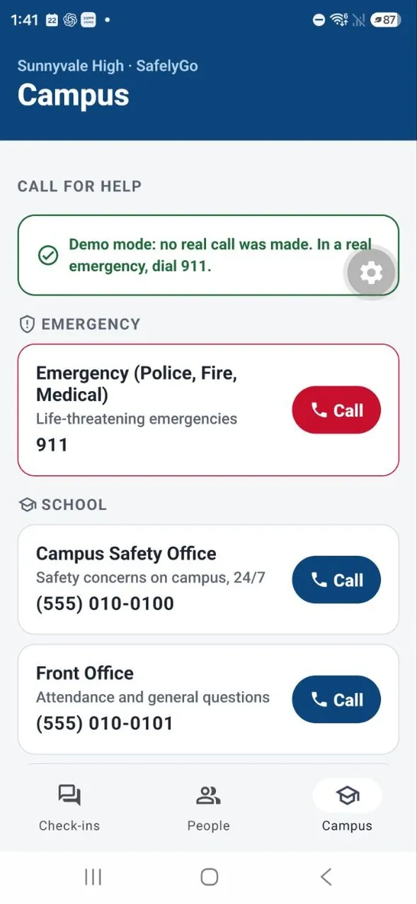
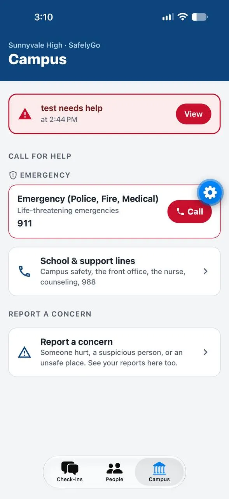
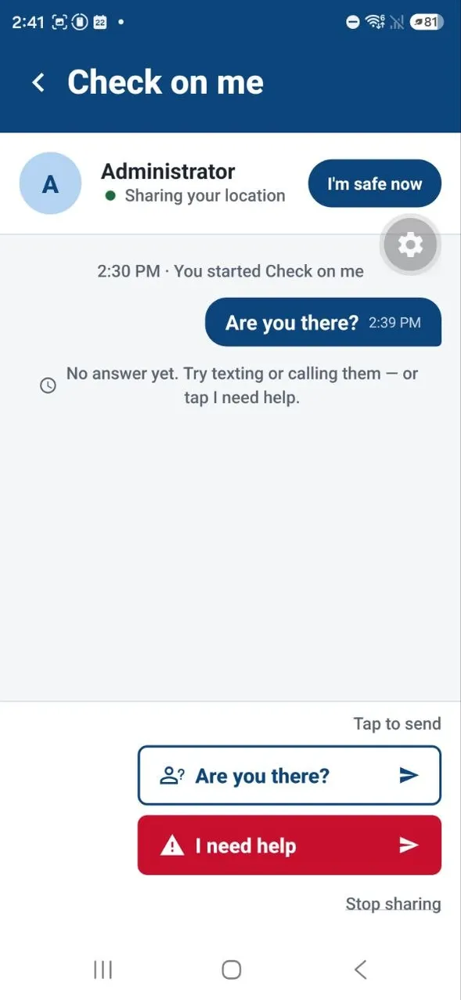

**The problem with the Campus tab:**
The Campus tab had two things: **Call for help** (911, the school office, campus safety, the nurse,
counseling, support lines) and **Report a concern**. All 7–8 phone numbers were listed first,
so "Report a concern" was hidden at the bottom. You had to scroll to even know it was there.

My first idea was to move the report card to the top. But that would just push 911 down.
The real problem wasn't the order. It was that one screen had too much on it, and soon the
live campus map has to fit there too.

**The fix: show only what's urgent, and open the rest**

  <figure>
    
    <figcaption>Before: a long list</figcaption>
  </figure>
  <figure>
    
    <figcaption>After: everything on one screen</figcaption>
  </figure>

- **911 stays on the screen**, still one tap away.
- **School & support lines** is one card. Tapping it opens the full list from the bottom.
  It's the same list that "I need help" opens, so the code is shared. On the Campus tab it leaves out
  911, because 911 is already right there. (I first showed 911 twice, and it looked strange.)
- **Report a concern** is now visible without scrolling, and there's room for the map below.

**One card for every screen**
When someone needs you, a card appears. On the Check-ins tab it was part of the page, but on other
tabs it was a different, smaller banner that floated over the top of the screen. It covered the
screen's title, and on the admin screen it even covered the back arrow.

Now the banner **is** the Home card. It's the same piece of code, placed right under the navy
header on every screen, so it's the same size, in the same place, with the same words.
I removed the "Later" button too. Home doesn't have one, and being able to hide
"needs help" didn't feel safe.

**"No answer yet" now says what to do**
If you ask "Are you there?" and nobody answers for 2 minutes, the conversation used to say only
"No answer yet." But you can already see that nobody answered. Saying it again only adds worry.
Now it says what you can do next:

It's still one gray line, with no new buttons and no alarm.

I kept **"Seen"** (when your person opens the conversation). The first thing you want to know after
asking for help is "did anyone notice?", and the other person doesn't have to do anything for it to show.

**What I learned:**
- If moving something up pushes something else down, the real problem is that there's too much on the screen.
- When two things show the same information, make them the same component. Then they always match.
- Every message should either tell you something new or tell you what to do.

**Next step:**
The live campus safety map goes in the space under "Report a concern".
