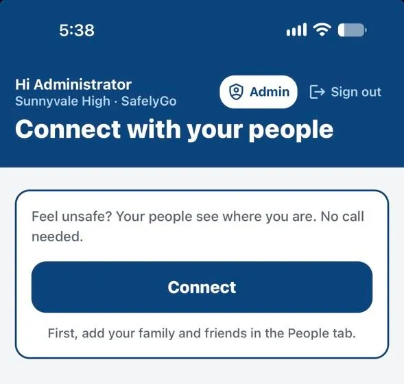

**"Check-ins" sounded like a hotel**
The first tab was called **Check-ins**. Every time I looked at it, it sounded like checking in at a
hotel or an airport. It didn't say what the tab is for: reaching *your people* when something feels off.

I renamed it **Connect**, with the title **"Connect with your people"**. Now the three tabs read like this:
- **Connect**: reach your people (Check on me)
- **People**: who your people are
- **Campus**: help from the school

My first suggestion was "Home". But "Home" sounds like the place where *everything* is, and this tab
isn't that. I also worried "Connect" would be confused with "Connected" in the People tab, but that's
just a status word, not a button. So "Connect" it is.

**One header for every tab**
After renaming, the header broke: on the admin account, the "Admin" and "Sign out" buttons squeezed
the title into two small lines. And each tab had different small text on top.
Now every tab has the same small line, "Sunnyvale High · SafelyGo". The Connect tab adds "Hi [name]"
above it, and the buttons sit next to the small lines, so the big title always gets the full width.

**A card that looks the same in every state**

The main card used to be navy with a white button, and the button didn't stand out.
Now the card is white and the **Connect** button is filled navy, so it's the strongest thing on the screen.
The text is one short sentence.

Here's a mistake I made twice: my two test phones showed *different* cards, because one account had
people connected and the other had none. I explained the reason, but the screens still looked
different. Explaining it isn't the same as fixing it. So now the card has the **same shape in every
state**: a sentence, the button, and one short line under it.
- With people: "You have 2 people connected"
- Without people: "First, add your family and friends in the People tab."

At first I showed people's names there, but more people or longer names would make the line wrap.
A number always fits, and the names appear on the next step anyway.

**Buttons that look "not said yet"**
In the conversation screen, the buttons at the bottom were bigger and bolder than the messages above,
which felt backwards. The rule now:
- **Messages (already said)** are filled bubbles.
- **Buttons (not said yet)** are outlines, and a bit smaller.
- **I need help** is a red outline on a light red background. It's still the only red thing, so it's
  easy to find.

**One way to end, not two**
There were two ways to end a Check on me: "I'm safe now" and "Stop sharing". But "test stopped sharing"
only made the other person worry. Are they OK or not? They'd have to call anyway. What they really want
to know is **"Are you OK?"** So now there's only **I'm safe now**: a white button with a green
outline at the top, apart from the message buttons, because ending isn't a message.
If you're *not* OK, you shouldn't end it. You should tap **I need help**.

**What I learned:**
- A name should say what the place is for, not what the code calls it.
- If a screen has different states, design them to look the same from the start.
- Style can carry meaning: filled = said, outline = not said yet, green = safe, red = help.
