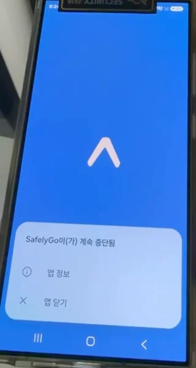

**Why build the APK now**
My submission link will be an **Android APK**, an app file you install directly without the Play Store.
Until now I only tested in Expo Go, a test app that loads my code from my computer.
But working in Expo Go doesn't guarantee that the real app works, so I built a **test APK**
early, while there's still time to fix problems.

**Getting ready**
- Gave the app a unique Android ID and changed the display name from "safelygo" to "SafelyGo".
- Updated the location permission text. It still talked about features I removed weeks ago.
- My database address and public key live in a `.env` file that is never uploaded (for security).
  So I saved them on Expo's **build server** too. Otherwise the app couldn't even log in.
- Building with **EAS Build** happens in the cloud: my code is uploaded, waits in a queue,
  and comes back as an APK download link. The free plan allows about 30 Android builds a month.

**Problem 1: "App blocked to protect your device"**


Android's Play Protect blocks apps that don't come from the Play Store. Tapping "More details"
shows "Install anyway". This isn't a bug, but **judges will see it too**, so my submission
instructions need one line explaining it.

**Problem 2: the app closed right away**



It showed the blue start screen, then "SafelyGo keeps stopping." My first guess was that the database
keys were missing, so I opened the APK file and searched it. The keys were there, so that wasn't it.

**How I found the real cause: adb**
Guessing is expensive here. Every fix needs a new build, which takes 20–30 minutes.
So I used **adb (Android Debug Bridge)**, a tool that connects a computer to an Android phone
over USB.
1. On the phone, I turned on **Developer options → USB debugging**, plugged it in, and tapped
   "Allow" for my computer. That prompt is a safety lock, so only computers you allow can connect.
2. With `adb logcat` I read the phone's **system log**. The phone only says "keeps stopping",
   but Android writes down *why* in the log.

The log said:

```
FATAL EXCEPTION: main
Failed to create an instance of class androidx.work.impl.WorkDatabase
```

**What it meant**
When building a real APK, a tool called **R8** makes the app smaller. It renames code to short names
(the log was full of names like `e31.q`) and removes code that looks unused. But an Android part
called **WorkManager** looks up its database class **by its original name** when the app starts.
R8 had renamed it, so the app couldn't find it and crashed.
Expo Go doesn't have this shrinking step, which is why I never saw the problem there.

**The fix**
I added a "keep" rule that tells R8: *don't rename or remove these classes.*
Then I built again and installed the new APK straight from my computer with `adb install`.
I launched it with adb and read the log again: **no errors**, and the app kept running.

**The result: a real app**
I turned off the Expo server on my computer, and the app still worked: login, my reports,
the map, all the buttons. It no longer depends on my computer at all. I installed it on a second
phone too.

**Two smaller things I learned**
- **Every build gets a new download link.** (My builds went: canceled, crashed, working.)
  For the submission I'll need one link that never changes, so I plan to host the final APK under a
  fixed name.
- After switching map labels to English, road-number badges ("90", "AH1") were stuffed with long road
  names and looked like white boxes. Now only place names switch to English. That fix will be in the
  next build.

**What I learned:**
- "It works in the test app" and "it works as a real app" are different claims. Test the real one early.
- Read the log before you guess. One log line saved me several 30-minute builds.
- The fix was one rule, but finding it needed the right tool.
