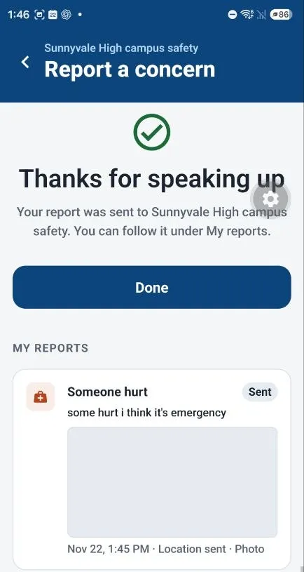
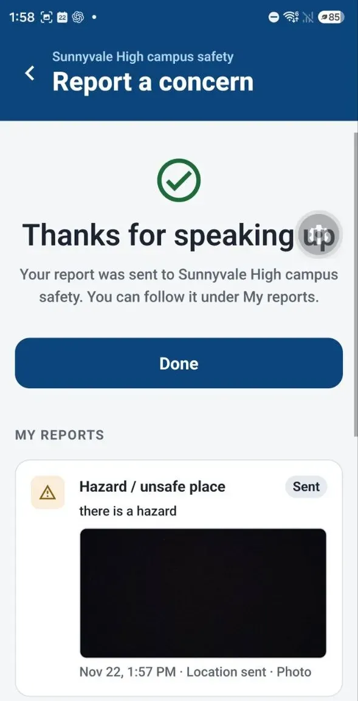
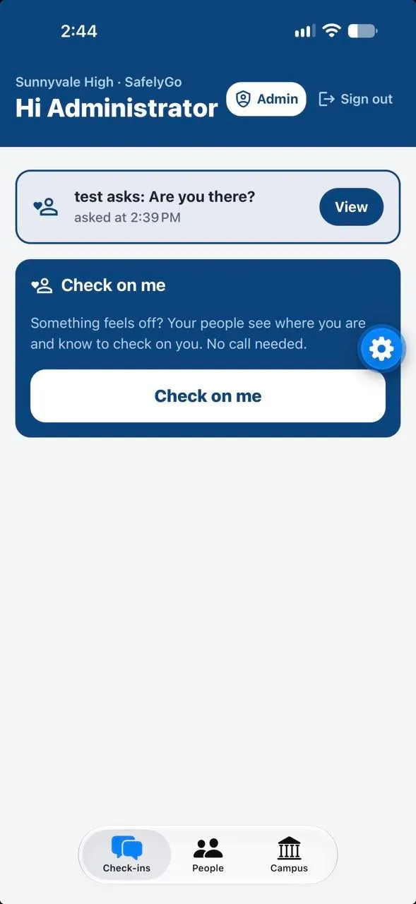
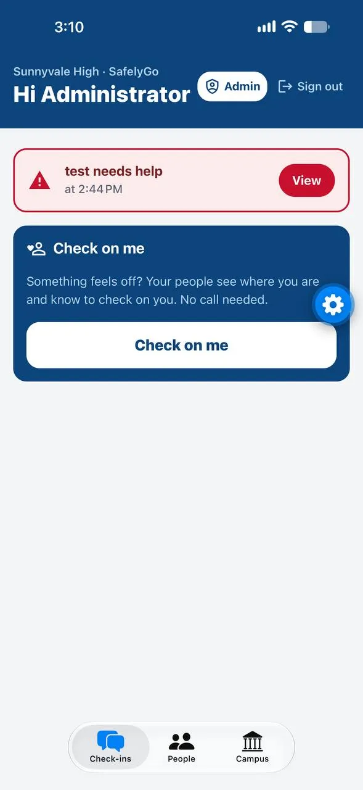

**Why I stopped building for a day:**
The next feature is a live campus safety map. But before starting it, I asked myself:
did I actually test everything I built last week? I went through my commits one by one and found
about 17 things I had built but never tried on a phone. The biggest reason: when I
[changed the tabs](/log/2026/11/16/safelygo-thread-and-help/), I moved the report screen, and after
that I never sent a single report again.

So I made a checklist (A to G) and tested it on my Android phone, my iPhone,
and my mom's phone as a third person.

**A. Reports: the photo was empty**
I sent a report with a photo. My Android camera is covered with a sticker, so the photo should be
black. Instead I saw a gray box.

  <figure>
    
    <figcaption>Before: an empty gray box</figcaption>
  </figure>
  <figure>
    
    <figcaption>After: the (black) photo shows</figcaption>
  </figure>

The gray was not the photo. It was the empty frame behind it. On Android, the way I read the photo
file gave back **zero bytes**, so the app uploaded an empty file. The upload "worked", so there was
no error, and that's why I didn't notice. Now:
- On phones, the app reads the file with Expo's file tools.
- If the file is empty, it stops and says the photo couldn't be uploaded.
- If a photo can't load, it says **"Photo couldn't load"** instead of showing a blank box.

Two smaller things on the same screen:
- A hint said 911 was "one tap in **Contacts**", but the Contacts tab doesn't exist anymore.
- A switch said **"Also notify my Guardians"**. "Guardians" is an old name, and the switch didn't
  actually notify anyone. It only saved a yes/no. I removed it. Reports go to the school, and
  Check on me is how you bring in your people. Keeping those two paths separate is simpler.

I also checked the admin side on my iPhone: the new report showed up with its photo, and when I
changed the status to "In review" with a note, my Android phone showed it right away.

**C. The most important bug: "I need help" was hidden**
On Android I tapped **I need help**. Inside the conversation, my iPhone showed it in red.
But on the Check-ins tab, the card still said **"test asks: Are you there?"**
If you don't open the conversation, you'd never know it's an emergency.

  <figure>
    
    <figcaption>Before: still "Are you there?"</figcaption>
  </figure>
  <figure>
    
    <figcaption>After: red "needs help"</figcaption>
  </figure>

The data was there. The problem was that **three places** (the Home card, the banner on other tabs,
and the row in My People) each decided on their own what to say, and none of them knew about
"I need help". When I added "I need help" to the conversation screen, I forgot the other three.

The fix was to put the decision in **one function** that all three use:
1. "needs help" (red) comes first,
2. then an unanswered "Are you there?",
3. otherwise "wants you to check on them".

Now they can't disagree with each other. Lesson: if the same decision is written in three places,
it will break in three places.

I also fixed small things here: the card said "since 2:30" (when it started) even though the
question was asked at 2:39, so now it says "asked at 2:39".

**D. Adding someone, with a real third phone**
My two test accounts were already connected, so I used my mom's phone. On her phone I typed my
test account's invite code, accepted it on my Android, and both showed "Connected".

One thing felt off: her screen didn't change to "Connected" until she switched tabs.
I tried making it update live, and it didn't work right away. Then I asked myself whether it even
needs to. Adding someone happens once, usually when you're standing next to each other, and it isn't
urgent. So I kept live updates only where seconds matter (Check on me and "I need help"),
and the waiting line now just says **"Pull down to update"**.

**E. Password reset from a phone: works**
Account recovery is a required feature, and until today it only worked on the computer.
I added the website's reset page to Supabase's list of allowed addresses, and then on my mom's phone:
Forgot password → email → the link opened the web page → new password → done.

One more fix: after saving, the phone's browser jumped straight into the web version of the app,
which was confusing ("which app am I in?"). Now it says **"Password changed"** and tells you to go
back to the SafelyGo app and sign in.

**What I learned:**
- "I built it" is not the same as "it works". Bugs showed up in screens I *didn't* change, next to
  ones I did.
- Testing with three real phones found things two phones couldn't.
- Not every problem needs more code. Sometimes the right fix is deciding a feature isn't needed.

**Next step:**
Now I can build the live campus safety map on top of something I trust.
